# ⚡ Awesome Workflow Automation Platform

  

  
  
  
  
  
  

---

## 🌟 Top Workflow Automation Platform Ecosystem

**Curated List of SaaS Products & Open-Source GitHub Projects**  
*Focused on No-Code Workflow Automation, iPaaS, AI Agent Orchestration & Self-Hosted Integration Platforms*  
**Last updated: October 2026**

This repository tracks notable **SaaS platforms** and **open-source projects** for **Workflow Automation Platforms**, enterprise iPaaS (Integration Platform as a Service), and autonomous AI agent orchestration. These tools enable software engineers, DevOps teams, integration architects, and business operators to seamlessly connect applications, automate mission-critical business processes, trigger event-driven pipelines, and orchestrate real-time data flows between disparate systems—dramatically reducing manual toil, preventing point-to-point integration sprawl, and ensuring end-to-end data governance.

**Examples** include Shopify Flow, Zapier, Make, Workato, Tray.io, Alloy Automation, n8n, Pipedream, Celigo, and MuleSoft Composer (the category leaders).

**Open-source emphasis**: Workflow Automation is a domain where open-source tooling is **exceptionally mature, developer-friendly, and production-proven**. Active projects like **n8n** (self-hostable platform with 1,500+ integrations and native multi-model AI agent nodes), **Huginn**, **Activepieces**, **Kestra**, and **Temporal** provide robust self-hosted alternatives with high throughput, fine-grained secret management, and distributed reliability.

Contributions are welcome! Please open a Pull Request to add or update entries. Keep descriptions factual and link to official documentation.

---

## 📑 Table of Contents

- [📊 Sector Overview & Market Dynamics](#-sector-overview--market-dynamics)
- [☁️ SaaS/Hosted Platforms](#️-saashosted-platforms)
- [🐙 Open-Source GitHub Projects](#-open-source-github-projects)
- [🛠️ Frameworks for Custom Architecture](#️-frameworks-for-custom-architecture)
- [🤝 How to Contribute](#-how-to-contribute)
- [⭐ Star History](#--star-history)
- [💖 Support & Sponsorship](#-support--sponsorship)
- [⚖️ Disclaimer](#️-disclaimer)

---

## 📊 Sector Overview & Market Dynamics

The global workflow automation and Integration Platform as a Service (iPaaS) market is valued at approximately **$25B to $28B**, expanding at a robust compound annual growth rate (**CAGR of ~10% to 12%**) through the late 2020s as enterprises accelerate hyperautomation and autonomous AI agent adoption. 

The sector remains **moderately to highly fragmented** rather than a winner-take-all monopoly: while enterprise cloud incumbents (Salesforce/MuleSoft, ServiceNow, Microsoft Power Automate) capture extensive enterprise lock-in and pure-play leaders (Zapier, Workato, Celigo) dominate self-serve and mid-market integration layers, no single vendor monopolizes the landscape. Instead, modern engineering organizations embrace a multi-tool "composition layer" approach—frequently combining specialized SaaS iPaaS for external partner APIs alongside resilient self-hosted open-source orchestration engines (such as n8n, Kestra, or Temporal) for internal security, zero-data-leakage compliance, and mission-critical reliability.

---

## ☁️ SaaS/Hosted Platforms

The table below catalogs premier SaaS workflow automation and iPaaS platforms, sorted in descending order by **Company Scale (Valuation / Revenue)**:

| Platform | Company Scale (Valuation / Revenue) 📈 | Pricing (Starting Tier) 💳 | Free Tier Limits / Free Trial 🎁 | Description 📝 |
| :--- | :--- | :--- | :--- | :--- |
| **[Shopify Flow](https://www.shopify.com/)** | **~$217B Market Cap** ($11.6B+ Annual Revenue) | **Included free with Shopify plans** (Shopify store plans start at $39/mo or $29/mo billed annually for Basic) | **Free forever with Shopify store plan**: up to 1,000 active/inactive workflows, rate limits scale with store API quota (2 req/sec standard), max 100 objects per data-fetch action; Shopify offers a 3-day free trial (no credit card required) | E-commerce automation platform built natively into Shopify; enables merchants to automate tasks like high-risk order review, inventory management, and customer segmentation without code. |
| **[MuleSoft Composer](https://www.mulesoft.com/)** | **$6.5B Acquisition** by Salesforce (~$300M+ Revenue baseline) | **Starts at ~$20,000–$25,000/yr** (~$1,666–$2,083/mo equivalent, annual contract via Salesforce) | **No public self-serve free tier or trial**; POC / trial sandbox org available upon request via Salesforce/MuleSoft Account Executive | Salesforce-native automation tool for connecting apps and data with clicks, not code; designed for business teams to build event-driven automations with IT governance. |
| **[Workato](https://www.workato.com/)** | **$5.7B Valuation** (~$150M ARR) | **Starts at ~$60,000/yr (~$5,000/mo)** for entry-level Base Platform tier (annual contract, custom sales quote) | **No public free tier or self-serve trial**; guided proof-of-concept (POC) sandbox available upon request via enterprise sales demo | Enterprise automation platform with AI-powered recipe building, low-code connectors, and comprehensive security compliance (PCI-DSS, ISO 27001, SOC 2, HIPAA); cloud-native architecture for scalability. |
| **[Zapier](https://zapier.com/)** | **$5.0B Valuation** (~$310M ARR) | **$19.99/mo** (billed annually at $239.88/yr) or $29.99/mo (billed monthly) for Professional plan (750 tasks/mo) | **Free Forever plan**: 100 tasks/month, 2-step Zaps (1 trigger + 1 action), unlimited Zaps/tables/forms, 15-minute polling interval; 14-day free trial of Professional tier | Market-leading no-code automation platform with 9,000+ app integrations; trigger-and-action workflows (Zaps) for connecting SaaS tools without engineering effort; includes AI steps, MCP support, and enterprise governance controls. |
| **[Make](https://www.make.com/)** | **~$1.5B+ Parent Val.** (Acquired by Celonis; ~$52M ARR) | **$9.00/mo** (billed annually) or $10.59/mo (billed monthly) for Core plan (10,000 credits/mo) | **Free Forever plan**: 1,000 credits/month, 2 active scenarios, 15-minute minimum schedule interval, 5 MB file size limit, 5-minute execution timeout | Visual automation platform (formerly Integromat) with 3,000+ pre-built apps; features a visual Scenario Builder, If-Else and Merge modules, scenario run replay, and Maia AI assistant for natural-language workflow generation. |
| **[Tray.io](https://tray.ai/)** | **$600M Valuation** (~$70M–$75M ARR) | **Starts at ~$500–$600/mo** (~$6,000–$7,000/yr billed annually) for Pro tier (annual contract) | **30-day free trial** with full connector library, workspace features, and up to 1,000,000 test tasks (no credit card required; no permanent free tier) | Low-code automation platform with powerful data transformation capabilities; features workspaces, projects, and services for organizing complex workflows; hundreds of pre-built connectors plus custom connector builder. |
| **[Celigo](https://www.celigo.com/)** | **~$400M+ Est. Val.** (~$85M–$95M ARR) | **Starts at ~$500–$600/mo** (~$10,000/yr entry contract for Standard edition) | **30-day free trial** with full access to endpoints and workflows; automatically downgrades to limited Free Edition (1 active flow, restricted endpoints) if not upgraded | Cloud-native iPaaS with flow builder, prebuilt connectors, and integration apps; embeds AI throughout for summaries, field mapping suggestions, and error categorization with auto-retry. |
| **[Pipedream](https://pipedream.com/)** | **~$150M–$200M Acquisition** by Workday (~$15M ARR) | **$29/mo** (billed annually) or $45/mo (billed monthly) for Basic tier (2,000 compute credits/mo, 10 active workflows) | **Free Forever tier**: ~100 compute credits/day, 3 active workflows, 3 connected accounts, 1M AI tokens (development environment); 1 credit ≈ 30s execution time | Developer-focused automation platform with SDKs for 3,000+ APIs, source-available component registry, and support for AI agents, workflow builders, and API orchestration; processes billions of events at scale. |
| **[Alloy Automation](https://runalloy.com/)** | **~$35M–$50M Valuation** (~$5M–$6M ARR) | **Starts at ~$50/connection/mo** for Unified API (custom embedded/enterprise annual contracts benchmark ~$7,500–$10,000/yr) | **Free tier for Unified API**: up to 10 active connections/month; enterprise evaluation via sales-guided demo/sandbox (no public self-serve free trial) | Integration platform designed for SaaS and AI; offers three approaches: Connectivity API for embedding native integrations, Embedded drag-and-drop orchestration, and MCP for AI agent access to 1000+ tools. |

---

## 🐙 Open-Source GitHub Projects

Leading open-source workflow automation and integration repositories, sorted in descending order by **GitHub Stars**:

- **[n8n](https://github.com/n8n-io/n8n)**   
  The leading open-source workflow automation platform (Sustainable Use License); combines a visual node-canvas with custom JavaScript/Python code; features 1,500+ community and official integrations, 9,000+ workflow templates, and native multi-model AI agent orchestration nodes (OpenAI, Anthropic, Google Gemini, Ollama, Hugging Face); fully self-hostable via Docker with enterprise RBAC, credential encryption, and audit logs.

- **[Apache Airflow](https://github.com/apache/airflow)**   
  Industry-standard programmatic workflow and data pipeline orchestration platform (Apache 2.0); defines workflows as Directed Acyclic Graphs (DAGs) using pure Python code; massive ecosystem of connectors, distributed task execution (Celery, Kubernetes), and deep monitoring.

- **[Huginn](https://github.com/huginn/huginn)**   
  Battle-tested, self-hosted system for building automated agents that monitor the web and take actions on your behalf (MIT License, Ruby); operates like a private, hackable IFTTT/Zapier with configurable event watchers, scrapers, digest emails, and webhook emitters.

- **[Kestra](https://github.com/kestra-io/kestra)**   
  Modern, event-driven, language-agnostic declarative orchestrator (Apache 2.0); defines both business automations and data workflows via intuitive YAML definitions and built-in UI; handles microservices orchestration, scheduled tasks, and real-time triggers with sub-millisecond execution.

- **[Activepieces](https://github.com/activepieces/activepieces)**   
  Open-source no-code automation tool designed as a privacy-first, community-driven Zapier alternative (MIT License); features TypeScript-based pieces, intuitive drag-and-drop canvas, npm-powered extensible connectors, and native webhook streaming.

- **[Temporal](https://github.com/temporalio/temporal)**   
  Durable execution platform for building resilient, code-first workflows (MIT License); guarantees workflow state preservation across server crashes, network failures, and infrastructure restarts across Go, TypeScript, Python, and Java.

- **[Windmill](https://github.com/windmill-labs/windmill)**   
  Extremely fast developer-first open-source alternative to Retool, Temporal, and Zapier (AGPL-3.0); turn scripts written in Python, TypeScript, Go, Bash, or SQL into auto-generated internal UIs, scheduled cron jobs, and high-throughput multi-step workflows.

- **[Automatisch](https://github.com/automatisch/automatisch)**   
  Self-hosted, privacy-first Zapier alternative (AGPL-3.0); allows connecting software without leaking sensitive customer information to third-party cloud services; perfect for GDPR, HIPAA, and compliance-sensitive operations.

- **[Pipedream](https://github.com/PipedreamHQ/pipedream)**   
  Source-available developer automation platform and open component registry; provides pre-built actions and triggers for thousands of APIs that can be combined with custom Node.js, Python, or Go steps; trusted by over 1,000,000 developers.

- **[RuleGo](https://github.com/rulego/rulego)**   
  Lightweight, high-performance, embedded component orchestration rule engine and workflow framework for Go (Apache 2.0); perfect for IoT edge computing, event routing, and heterogeneous data transformation.

- **[µTask](https://github.com/ovh/utask)**   
  Declarative, idempotent automation engine developed by OVHcloud (Apache 2.0); models and executes business processes declared in YAML with built-in rollback capabilities and resolution workflows.

- **[ByteChef](https://github.com/bytechefhq/bytechef)**   
  Open-source, low-code API integration and workflow automation engine (Apache 2.0); Java-based extensible platform designed for embedding iPaaS capabilities inside B2B SaaS applications.

- **[Flowpipe](https://github.com/turbot/flowpipe)**   
  Cloud scripting and DevOps workflow engine (AGPL-3.0); connects cloud APIs, code, and systems with simple HCL/YAML pipelines for infrastructure operations, incident response, and security remediations.

- **[PneumaticWorkflow](https://github.com/pneumaticapp/pneumaticworkflow)**   
  Lightweight Python-based workflow automation engine (Apache 2.0); streamlined templates for standard operating procedures (SOPs), repeatable business tasks, and team process routing.

---

### 🛠️ Frameworks for Custom Architecture

For teams building internal automation backbones:
- **Visual & AI-First Automation**: Combine **n8n** or **Activepieces** for canvas-based visual orchestration, prompt-driven flows, and 1,500+ connectors.
- **Durable Code-First Microservices**: Combine **Temporal** or **Kestra** for resilient code-as-workflow execution with guaranteed delivery.
- **Embedded iPaaS in B2B Products**: Leverage **ByteChef** or **Pipedream** components to ship user-facing native integrations in record time.

---

## 🤝 How to Contribute

Contributions make the open-source community a vibrant place to build, learn, and collaborate! 🚀

1. 🍴 **Fork the repository** to your personal account.
2. 🌿 **Create a Feature Branch** (`git checkout -b feature/AddAwesomePlatform`).
3. 📝 **Add/edit entries** in `README.md` (keep descriptions concise, objective, and adhere to table/list formatting).
4. 🔎 **Verify data** (ensure pricing, free tier limits, and links are valid).
5. 💾 **Commit your changes** (`git commit -m 'Add <Platform> with pricing and free limits'`).
6. 🚀 **Push to the branch** (`git push origin feature/AddAwesomePlatform`).
7. 📬 **Submit a Pull Request** with a brief summary of the addition.

🌟 **Found this repository helpful? Give it a star to support the project!**

---

## 📈 Star History

---

## 💖 Support & Sponsorship

If you find this curated collection useful for your projects, architecture design, or daily workflow automation research, please consider supporting continued maintenance and updates! 🙏

- ⭐ **Star this repository** on GitHub to help others discover it.
- 🍴 **Fork and share** with fellow developers, DevOps teams, and automation engineers.
- ☕ **Buy me a coffee & support ongoing work**: Visit the [GitHub Sponsor Dashboard](https://github.com/sponsors/ishandutta2007) to become a patron or sponsor!

---

## ⚖️ Disclaimer

- This is a **community-curated collection** — not an official endorsement of any commercial platform or open-source software project.
- Workflow automation platforms handle business data, authentication tokens, and credentials; always ensure implementations comply with organizational security policies, HIPAA, SOC 2, and GDPR standards. Encrypt all API credentials and enforce automated token rotation.
- **Open-source tooling maturity**: Projects like n8n, Activepieces, Temporal, and Kestra offer world-class alternatives to commercial tools. However, enterprise-scale compliance certifications, dedicated SLAs, and turnkey embedded iPaaS suites may still favor enterprise commercial vendors (Workato, Celigo, MuleSoft).
- Always verify official licensing terms before deploying in commercial environments (e.g., Sustainable Use License for n8n, Apache 2.0, MIT, or AGPL-3.0).

---

  <b>Built with ❤️ for integration engineers, automation developers, DevOps teams, and business process architects.</b> 
  Let's make workflow automation more open, AI-ready, resilient, and integration-friendly! 🚀

